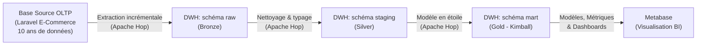

# Plateforme BI E-Commerce — PostgreSQL, Apache Hop & Metabase

Projet de Business Intelligence **end-to-end** en conditions réelles : extraction depuis une base applicative **OLTP** (Laravel / PostgreSQL simulée sur **10 ans** et plusieurs millions de lignes), transformation **ETL** avec **Apache Hop**, modélisation **Data Warehouse** (architecture Médaillon + modèle en étoile de Kimball) dans **PostgreSQL**, et restitution décisionnelle dans **Metabase**.

> [!NOTE]
> Projet en cours de construction — la progression étape par étape est suivie dans [ROADMAP.md](./ROADMAP.md) et la documentation technique détaillée dans [DOC.md](./DOC.md).

---

## Architecture globale



---

## Stack technique

| Composant | Rôle | Version / Image | Port par défaut |
| :--- | :--- | :--- | :--- |
| **PostgreSQL** | Base source OLTP (`ecommerce_oltp`), Data Warehouse (`dwh`) & métadonnées Metabase (`metabase_app`) | `postgres:16-alpine` | `${POSTGRES_PORT}` (`5433`) |
| **Apache Hop Web** | Conception & orchestration des pipelines ETL (`.hpl` / `.hwf`) | `apache/hop-web:2.20.0` | `${HOP_PORT}` (`8081`) |
| **Metabase** | Couche sémantique, exploration SQL/Visuelle, KPIs & Dashboards | `metabase/metabase:v0.64.6` | `${METABASE_PORT}` (`3000`) |
| **Laravel (dépôt frère)** | Génération du schéma applicatif OLTP et seeding massif sur 10 ans | Workspace séparé (`../ecommerce-oltp`) | — |

---

## Démarrage rapide

### 1. Préparer les variables d'environnement
Copier le fichier d'exemple et renseigner vos propres identifiants dans `.env` (ignoré par Git) :

```bash
cp .env.example .env
```

### 2. Lancer la stack Docker
```bash
docker compose up -d
```

### 3. Accéder aux services
- **Apache Hop Web** : `http://localhost:8081` (identifiants définis dans `.env`)
- **Metabase** : `http://localhost:3000`
- **PostgreSQL (depuis l'hôte)** : `localhost:5433`

---

## Structure du dépôt

```text
.
├── .agents/                  # Skills et plugins locaux (MCP Metabase, suivi doc)
├── hop-jdbc/                 # Pilotes JDBC additionnels (ignorés si .jar)
├── hop-projects/bi-learn/    # Pipelines (.hpl) et Workflows (.hwf) Apache Hop
├── postgres-init/            # Script d'initialisation PostgreSQL au 1er démarrage
├── scripts/                  # Scripts d'automatisation (Python / Bash)
├── sql/dwh/                  # Scripts DDL versionnés du Data Warehouse (raw, staging, mart)
├── .env.example              # Modèle des variables d'environnement
├── docker-compose.yml        # Orchestration des services BI
├── DOC.md                    # Documentation technique vivante
└── ROADMAP.md                # Feuille de route pédagogique étape par étape
```

---

## Documentation
- **[ROADMAP.md](./ROADMAP.md)** : Plan d'apprentissage et d'implémentation étape par étape (de la base source OLTP jusqu'aux dashboards Metabase).
- **[DOC.md](./DOC.md)** : Référentiel technique (services, dictionnaire de données, pipelines ETL, métriques et décisions d'architecture).
